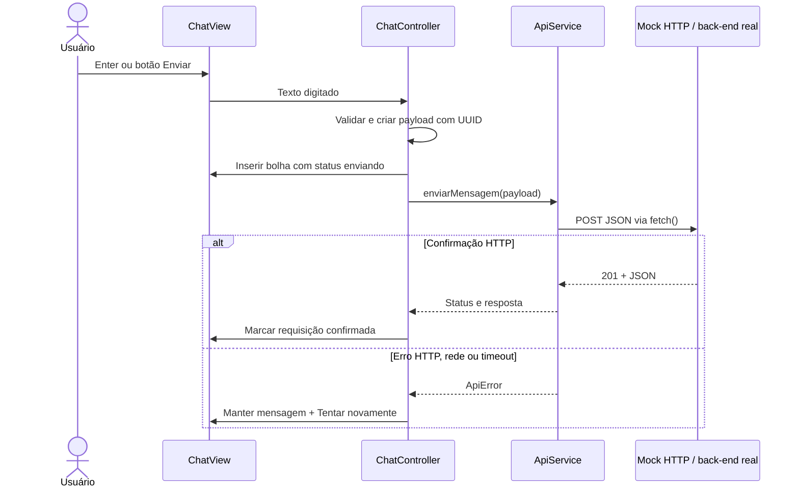

# RADACHE · Protótipo de mensagens

Interface inspirada no WhatsApp Web, em **HTML5, CSS3 e JavaScript nativo com ES Modules**, para demonstrar envio otimista e validar o contrato HTTP de mensagens. Não precisa de npm, framework, CDN, conta Meta ou conexão externa.

## Simulação da conversa do aluno (modo padrão)

Ao abrir `/mensagens/`, você assume o papel de um aluno fictício e conversa com o assistente RADACHE. A experiência usa exatamente os textos do roteiro fornecido pelo projeto, incluindo convite, perguntas, encerramento, recusa, revogação, resposta inválida, lembrete e áudio não suportado.

1. Selecione um aluno: no primeiro contato, o bot envia **radache_boas_vindas**, com a explicação completa e autorização por 12 meses. Responda **1** para aceitar ou **2** para recusar.
2. Ao aceitar, responda a pergunta financeira (1–4) e a emocional (1–5), digitando ou usando as respostas rápidas.
3. A conclusão mostra a mensagem de encerramento. Abra **Dados do check-in simulado** para conferir F e P. O protótipo não calcula o RE total, pois não possui todos os componentes acadêmicos.
4. Teste **REVOGAR**: o consentimento e os valores F/P são limpos, e as respostas sensíveis no histórico visível são substituídas por “Resposta removida após revogação”. **INICIAR** pede novo consentimento.
5. Teste **+ 3 dias** em uma etapa pendente para receber o lembrete. O botão avança o relógio virtual, sem esperar tempo real. Há no máximo um lembrete por check-in; recusa, revogação e conclusão não geram lembretes.
6. Use **Próximo mês**: com consentimento válido, o bot envia **radache_mensal** e entra em **aguardando_inicio**. Somente **1** inicia a pergunta financeira; essa resposta não altera a data do consentimento. **Reiniciar** restaura somente o aluno selecionado.
7. O botão de nota musical **♪** simula uma mensagem de áudio, sem gravar ou acessar o microfone. O bot responde com o texto do roteiro para mídia não suportada.
8. Use **+12 meses** para testar o vencimento: **radache_boas_vindas** substitui o mensal e pede novo aceite. Em **Dados do check-in simulado**, confira a data original e a validade; aceitar a renovação atualiza ambas.

| Situação | Template simulado | Estado seguinte |
| --- | --- | --- |
| Primeiro contato, sem autorização ou autorização vencida | `radache_boas_vindas` | `consentimento` |
| Novo mês com autorização válida | `radache_mensal` | `aguardando_inicio` |
| Check-in pendente e três dias sem resposta | `radache_lembrete` | Preserva a etapa pendente |

O estado guarda `dataConsentimento` e calcula `validadeConsentimento` com **12 meses de calendário**. No instante do vencimento a autorização já está inválida. O cálculo trata meses com dias diferentes e anos bissextos (aceite em 29/02 vence em 28/02 do ano seguinte). Avanços mensais preservam o dia de referência quando ele existe no mês de destino. Um vencimento durante a espera das perguntas retorna às boas-vindas e impede continuar antes do novo aceite. No convite mensal, **2** é uma opção inválida; a saída continua sendo **REVOGAR**, como informado no texto.

`dataConsentimento` é mantida somente na memória da aba, como os demais dados da simulação. A implantação real deverá persistir essa data por participante no banco; esta alteração não muda o esquema nem o fluxo do back-end institucional. As perguntas e demais respostas do roteiro foram mantidas. As únicas mensagens automáticas enviadas pelo relógio virtual são os três templates; perguntas e respostas de texto livre são produzidas após uma mensagem do aluno.

Cada aluno tem estado, histórico, relógio e rascunho independentes. Respostas inválidas repetem a pergunta sem preencher os dados. Após concluir no mês, novas respostas recebem o aviso “Suas respostas deste mês já foram registradas”. A recusa permite INICIAR novamente. Não há armazenamento no banco: “registradas” e “apagadas” nas mensagens representam as transições do cenário fictício em memória. O painel Network do navegador, como qualquer inspeção de rede, pode continuar mostrando os POSTs já realizados.

A correspondência financeira é **1→0, 2→33, 3→66, 4→100**. O componente emocional usa **P = ((5 − resposta) / 4) × 100**. Os dois são exibidos separadamente do RE total.

A arquitetura acrescenta três módulos:

- `js/data/checkin-textos.js`: catálogo dos textos fornecidos, separado das regras.
- `js/services/checkin-simulator.js`: máquina de estados e relógio virtual, sem DOM, HTTP ou banco.
- `js/simulation-controller.js`: coordenação das interações do aluno, respostas automáticas, falhas e limpeza dos dados simulados.

As respostas do aluno ainda geram POSTs reais para o mock local, com `id_remetente` do aluno fictício e `id_destinatario: 1` (RADACHE). Se o POST falhar, a etapa não avança e a bolha oferece retry. O mesmo UUID é reaproveitado; um retry antigo é cancelado se o cenário já mudou de etapa ou ciclo. As mensagens automáticas e templates são gerados localmente; não são cadastrados ou enviados à Meta. O roteiro de tempo é uma regra da demonstração, sem validação de aprovação, categoria ou cobrança da plataforma.

## Teste manual da API (modo técnico)

O comportamento original continua em **`/mensagens/?modo=api`**, pelo link **Abrir teste manual da API**. Nesse modo, você envia mensagens como coordenação, sem respostas automáticas. As instruções técnicas abaixo descrevem esse contrato e a integração real.

Na simulação padrão, a URL do POST é fixada no mock local para preservar a demonstração mesmo se `API_CONFIG.endpoint` for alterado para um servidor real. A configuração da API real afeta apenas o modo técnico.

## Executar

**Demonstração isolada, sem acessar o banco:** dê dois cliques em `INICIAR_MENSAGENS.bat`, na pasta principal fornecida, e abra **http://localhost:8081/mensagens/**. O inicializador procura Python 3 no computador e abre o navegador. Mantenha o console aberto; use `Ctrl+C` para encerrar.

Alternativa pelo terminal, a partir de `hackaTIU-master LAB engenharia de software`:

```powershell
python scripts/iniciar_mensagens.py
python scripts/iniciar_mensagens.py --port 8082 --no-browser
```

**Dentro do RADACHE existente:** execute `INICIAR_RADACHE.bat` e abra **http://localhost:8080/mensagens/**. O cabeçalho do gerenciamento de alunos também contém o link **Mensagens**. Reinicie um servidor que já estava rodando para carregar as rotas novas. Os ícones de acesso ao RADACHE levam à raiz do servidor; no inicializador isolado, a raiz retorna ao próprio protótipo.

Abra por HTTP. O duplo clique direto em `index.html` não oferece o endpoint mock e pode bloquear módulos ES pelo protocolo `file://`. O comando `python -m http.server` serve os arquivos, mas não implementa o POST.

## Organização e responsabilidades

```text
RADACHE_Modulo_Alunos/
├── frontend/mensagens/
│   ├── index.html                 HTML semântico e estrutura acessível
│   ├── styles.css                 CSS puro, Grid/Flexbox e responsividade
│   ├── pattern.svg                Ilustração vetorial local do fundo
│   ├── js/
│   │   ├── config.js              Endpoint e configuração do chat
│   │   ├── app.js                 Controlador e estado por conversa
│   │   ├── data/demo.js           Contatos/históricos exclusivamente fictícios
│   │   ├── models/mensagem.js     Validação e criação do payload
│   │   ├── services/api-service.js  ApiService.enviarMensagem(), único fetch
│   │   └── ui/chat-view.js        Manipulação do DOM e eventos de interface
│   └── README.md
└── backend/
    ├── mock_mensagens.py          Mock HTTP: valida/retorna JSON, não persiste
    ├── app.py                     Servidor existente com rotas adicionais
    └── tests/test_mock_mensagens.py
scripts/
├── iniciar_mensagens.py            Servidor Python isolado, sem banco
└── verificar_mensagens.py          Validação real no navegador e evidências
```

| Camada | Responsabilidade | Motivo da separação |
| --- | --- | --- |
| View (`ChatView`) | Renderizar contatos/bolhas, capturar eventos e mostrar status | Alterações visuais não modificam o transporte HTTP |
| Controlador (`ChatController`) | Estado, envio otimista, rascunhos, troca de contato e correlação das respostas | Evita misturar regras do fluxo com seletores DOM e `fetch` |
| Modelo (`criarPayload`) | Validar texto/IDs e gerar UUID/timestamp | Contrato testável sem interface ou rede |
| Serviço (`ApiService`) | POST, headers, timeout, leitura da resposta e erros | A integração real é configurada em um único lugar; aceita injeção de `fetch` |
| Mock Python | Receber uma requisição HTTP real e validar o contrato | Permite inspecionar o POST na aba Network, sem simular sucesso com `setTimeout` |

## Fluxo de envio



A inserção no DOM acontece **antes** de chamar `ApiService.enviarMensagem()`. A UI não aguarda a promessa da rede e permite outros envios enquanto uma resposta está pendente. As respostas atualizam a bolha do UUID original, mesmo se o usuário trocar de conversa. Rascunhos também são separados por destinatário.

O retry reaproveita o payload completo e `id_cliente`, sem criar outra bolha. Não existe retry automático. Em timeout ou falha de rede, o servidor pode ter recebido a requisição; por isso o endpoint real deve implementar idempotência com uma restrição UNIQUE em `id_cliente`.

## Contrato do POST

Endpoint padrão: **`POST /mock-api/mensagens`**, `Content-Type: application/json`.

```json
{
  "id_cliente": "da16077f-0230-48cc-966b-a3ce23635312",
  "conteudo_texto": "Olá, Ana! Como estão as aulas?",
  "id_remetente": 1,
  "id_destinatario": 101,
  "timestamp": "2026-10-26T14:30:00.000Z"
}
```

| Campo | Tipo | Significado para o banco relacional |
| --- | --- | --- |
| `id_cliente` | UUID em string | Identificador de idempotência; recomendado UNIQUE |
| `conteudo_texto` | string | Conteúdo textual não vazio; máximo 4000 caracteres |
| `id_remetente` | inteiro positivo | FK do participante remetente; em produção deve corresponder à sessão |
| `id_destinatario` | inteiro positivo | FK do participante destinatário, autorizado para a conversa |
| `timestamp` | string ISO 8601 UTC | Instante informado pelo cliente; mantenha também um instante de recebimento do servidor |

**Importante para a modelagem:** os IDs 1 e 101–106 são fictícios e não são IDs reais da tabela `alunos`. Defina uma entidade de participantes com as FKs adequadas aos usuários institucionais e estudantes antes de persistir este contrato. O protótipo não cria tabelas nem altera o banco atual.

Resposta do mock: **201 Created**.

```json
{
  "sucesso": true,
  "modo": "mock",
  "persistido": false,
  "dados": {
    "id_cliente": "da16077f-0230-48cc-966b-a3ce23635312",
    "conteudo_texto": "Olá, Ana! Como estão as aulas?",
    "id_remetente": 1,
    "id_destinatario": 101,
    "timestamp": "2026-10-26T14:30:00.000Z",
    "id_mensagem": "5da9696e-f31c-4843-9031-5d7574600f34"
  }
}
```

`id_mensagem` é uma identificação sintética da resposta. O mock não tem histórico, deduplicação ou persistência; respostas de duas tentativas podem gerar IDs sintéticos distintos. A idempotência deve ser implementada no back-end real, que devolverá a mesma mensagem para o mesmo `id_cliente`.

Erros têm o formato `{"sucesso": false, "erro": "Descrição"}`: **400** para JSON/payload inválido, **413** para corpo maior que 32 KiB e **415** para Content-Type incompatível. O mock não acessa SQLite, não chama serviços da Meta e não autentica dados fictícios. Os endpoints privados existentes `/api/` continuam exigindo autenticação.

## Conectar a API real

1. Em **`js/config.js`**, substitua `API_CONFIG.endpoint` pela URL real, por exemplo `'/api/mensagens'`, e altere `modo` para `'real'`.
2. Em **`js/services/api-service.js`**, configure o mecanismo de autenticação adotado pelo back-end. O padrão é `credentials: 'same-origin'`; não há token institucional no protótipo. Para a sessão Bearer usada pelo RADACHE, inclua o token obtido pelo login no header `Authorization`, sem fixá-lo no código. Se usar outra origem, ajuste CORS e credenciais de forma correspondente no servidor.
3. Troque `data/demo.js` pela obtenção dos contatos/históricos autorizados e obtenha o remetente da sessão. O servidor deve validar essa identidade e autorizar o destinatário; não confie no ID enviado pelo navegador.
4. Implemente validação, FKs reais e INSERT parametrizado em transação no back-end. A deduplicação deve acontecer na mesma transação da gravação.
5. Responda **200/201** com `{"sucesso": true, "dados": {"id_mensagem": "..."}}`. **204 No Content** também é aceito. Um JSON com `sucesso: false`, um status HTTP de erro ou uma resposta fora desse contrato mantém a mensagem com falha na tela.

O JSDoc de `ApiService.enviarMensagem()` repete esses pontos junto ao `fetch()`, no local em que a equipe fará a integração. O timeout padrão é de dez segundos e cobre tanto a requisição quanto a leitura do corpo.

## Roteiro de apresentação

1. Mostre o layout: contatos à esquerda, chat à direita, tons verde/cinza e interface responsiva.
2. Busque um contato, filtre as não lidas e abra uma conversa.
3. Digite e envie por Enter; use Shift+Enter para demonstrar várias linhas.
4. Clique no ícone **`</>`** do cabeçalho e confira endpoint, payload e HTTP 201. A resposta informa `persistido: false`.
5. Em DevTools → Network, filtre por `mensagens` e mostre o POST, os headers e o corpo JSON.
6. Com a página carregada, ative **Offline** em DevTools e envie outra mensagem. A bolha permanece com **Tentar novamente**. Retorne a **Online**, clique em tentar novamente e confirme que o UUID foi mantido.
7. Troque entre contatos para demonstrar histórico e rascunhos independentes. Recarregue para demonstrar que o mock não persiste o histórico.

Estados visuais: relógio = envio pendente; um check = requisição aceita pela API; exclamação e botão = falha. Os dois checks do histórico inicial são apenas ilustrações de mensagens fictícias. Nenhum check representa confirmação de entrega/leitura por um destinatário real.

## Verificação

Na pasta `RADACHE_Modulo_Alunos/backend`:

```powershell
python -m unittest discover -s tests -p test_mock_mensagens.py -v
```

Na pasta `hackaTIU-master LAB engenharia de software`, com Playwright disponível e Edge instalado:

```powershell
uv run --no-project --with playwright python scripts/verificar_mensagens.py
```

O teste de navegador sobe servidores temporários em portas livres, faz POSTs HTTP reais e verifica envio otimista com resposta suspensa, concorrência entre contatos, retry, falhas, texto seguro, busca, rascunhos, inspeção JSON e layout móvel. Os servidores são encerrados ao final. As evidências ficam em `validacao/mensagens/`.

## Limites do protótipo

- Histórico e rascunhos estão na memória da aba; recarregar restaura os exemplos.
- Não há recebimento em tempo real, anexos, áudio, sincronização ou integração com o WhatsApp oficial.
- Texto de mensagem e respostas de API são inseridos com `textContent`, sem interpretar HTML do usuário.
- O mock valida formato, não a existência real dos participantes ou autorização institucional.
- O inicializador isolado escuta apenas em `127.0.0.1`, não abre o banco e não inicia o agendador existente do RADACHE.
- HTML, CSS, módulos JS e a ilustração são locais. A interface usa a fonte Inter se já instalada, com fallback para Segoe UI/Arial, sem downloads.
